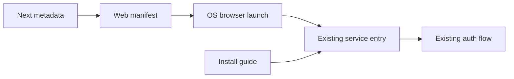

# 技術設計書: frontend-pwa-standalone

## Overview

スマートフォン利用者がホーム画面からjongboを起動したとき、ブラウザー操作部分を隠したstandalone表示で利用できるようにする。Next.js App Routerの標準metadata規約とWeb App Manifestを用い、既存ブランドに沿うアプリ名・アイコン・テーマ色を提供する。これはブラウザーエンジン上で動くWebアプリであり、ネイティブアプリ配布は行わない。

対象利用者はiPhone SafariまたはAndroid Chromeからjongboを使う人である。インストール手順を公開ページにまとめ、既存のログイン画面およびモバイルナビゲーションから案内する。既存のサービス入口とFirebase認証方針は維持する。

### Goals

- iOS 16.4以降のSafariでホーム画面に追加したWebアプリ、およびAndroid Chromeでインストール・追加したアプリをstandalone表示で起動する。
- 端末のホーム画面で識別できるブランド名・アイコンとテーマ色を提供する。
- インストール手順を利用者が確認でき、ノッチ・システム操作領域のある画面でも主要操作を利用可能にする。
- 通常のブラウザー利用と既存の認証フローを維持する。

### Non-Goals

- オフライン、Service Worker、Push通知、バックグラウンド同期。
- App Store / Google Play向けのネイティブアプリや端末APIの提供。
- Safariとホーム画面Webアプリ間の認証状態共有、認証方式・保存期間の変更。
- Android Chrome以外のブラウザーにおける同じインストール動作の保証。
- 利用者に代わるホーム画面追加操作。

## 責務境界の確約 (Boundary Commitments)

### この仕様が所有する責務 (This Spec Owns)

- Next.jsが返すWeb App Manifest、アプリ起動表示・識別metadata、ホーム画面用アイコン。
- iPhone SafariとAndroid Chromeのホーム画面追加手順を表示する公開ページと、そこへ到達するUIリンク。
- 共通アプリシェル、認証フォームシェル、固定モバイルドロワーにおけるsafe-area余白。
- ホーム画面アプリ内でも既存のサービス入口とログイン経路へ接続すること。

### 対象外 (Out of Boundary)

- Firebase Authの認証方式、セッション永続化設定、認証ガード、Firestore/API。
- SafariとWebアプリ間のセッション共有、オフラインキャッシュ、同期・通知。
- ネイティブ実装、配布ストア、端末機能連携。
- iOSの「Webアプリとして開く」設定の強制。対応する選択肢が表示される場合の有効化は利用者が行う。

### 許可される依存関係 (Allowed Dependencies)

- Next.js 15 App Routerのmanifest、metadata、viewport規約と既存のReactレイアウト。
- 既存デザイントークン（ブランド色 #e8736b、背景色 #ffffff）、Header、AppShell、AuthFormShell。
- OSブラウザーのWeb App Manifest、ホーム画面追加、CSS safe-area inset対応。
- 既存のFirebase Auth Providerとサービス入口。認証契約への変更は許可しない。
- 新しいPWAライブラリ、Service Worker、バックエンド依存を追加しない。

### 再検証を要する変更 (Revalidation Triggers)

- Manifestのstart_url、scope、display、name、iconsまたは公開パスを変える場合。
- iOS/Androidの対応バージョンやインストール手順、OSの起動仕様が変わる場合。
- AppShell、AuthFormShell、Headerの配置・固定要素、viewport設定を変える場合。
- 既存のログイン入口またはFirebase認証保存方針を変える場合。
- 新たにService Worker、オフライン、通知、他ブラウザー対応を導入する場合。

## Architecture

### 既存アーキテクチャ分析

フロントエンドはNext.js 15 App Routerで、rootのlayoutが全ページmetadataとProviderを設定する。サービス入口は /、認証フォームは /login、保護画面は既存のAppShellと認証Providerを利用する。共通Headerにはモバイル用固定ドロワーがある。PWA設定やsafe-area指定はまだない。

### アーキテクチャパターンと境界

**選択パターン**: Next.js標準metadataによるブラウザー統合。OSがManifestとアイコンを使ってstandalone起動を行い、ページ内は既存の共通UI・認証構成を使う。外部ライブラリや新規実行時サービスを追加しない。

**依存方向**: Next.js root metadata → Manifest / static icon assets → OS browser launch context → existing App Router service entry → existing UI and auth. インストール案内は既存のAppShellに属し、認証層へ依存しない。

### 技術スタック

| レイヤー | 選択・バージョン | 役割 | 備考 |
|---|---|---|---|
| Frontend | Next.js 15 App Router、React 19 | Manifest、root metadata、案内ページ | 既存スタックを継続 |
| Browser integration | Web App Manifest、HTML metadata | standalone起動、アプリ識別、テーマ色 | ブラウザー標準 |
| UI | Tailwind CSS 4、既存CSS | safe areaと案内リンク | 新規依存なし |
| Backend / Data | 変更なし | 認証と記録データ | 既存契約を維持 |

Next.jsのmanifest規約は [Manifest metadata file](https://nextjs.org/docs/15/app/api-reference/file-conventions/metadata/manifest)、アイコンは [App icons](https://nextjs.org/docs/15/app/api-reference/file-conventions/metadata/app-icons) を使う。viewportは viewportFit: "cover" と themeColor を宣言する。[iOS WebKit](https://webkit.org/blog/13878/) と [Android Chrome](https://developer.chrome.com/blog/whats-new-in-web-on-android-io2023) のインストール条件を案内ページに反映する。

## ファイル構成計画 (File Structure Plan)

### 新規作成ファイル

- frontend/src/app/manifest.ts — アプリ名、short name、start URL /、scope /、display standalone、背景色、テーマ色、アイコン参照を返す。
- frontend/src/app/install/page.tsx — iPhone SafariとAndroid Chromeの追加手順を提示する公開ページ。OS判定は行わず、両方の説明を表示する。
- frontend/public/icons/jongbo-192.png — Manifestの通常アイコン。
- frontend/public/icons/jongbo-512.png — Manifestの大サイズ通常アイコン。
- frontend/public/icons/jongbo-512-maskable.png — Androidのアイコンマスキング用。安全領域に既存の4タイルロゴを配置する。
- frontend/public/icons/jongbo-apple-touch.png — iOS用180px Apple touch icon。

### 変更ファイル

- frontend/src/app/layout.tsx — 既存title/descriptionにPWA iconとApple Web App metadataを加え、Viewportでtheme colorとviewport fitを宣言する。
- frontend/src/app/styles/globals.css — safe-area insetを利用する共通クラスを定義し、通常端末で既存余白を損なわない。
- frontend/src/components/layout/app-shell/index.tsx — アプリ画面の最小高さとsafe-area用クラスを適用する。
- frontend/src/components/layout/auth-form-shell/index.tsx — ログイン等の認証フォームをsafe area内に配置する。
- frontend/src/components/layout/header/index.tsx — sticky Headerと固定モバイルドロワーにsafe-area余白を適用し、ドロワーへ案内リンクを追加する。
- frontend/src/app/login/page.tsx — 未ログイン利用者が案内ページへ移動できるfooter linkを追加する。

### 変更しない既存の接続点

- frontend/src/app/page.tsx と frontend/src/app/hooks/index.ts — Manifestの起動先 /。現在のサービス入口と未認証時の /login 遷移を維持する。
- frontend/src/providers/auth-provider.tsx と frontend/src/lib/firebase/auth.ts — 既存認証状態・browserSessionPersistenceを維持する。

## Components and Interfaces

| Component | Domain | Intent | Req Coverage | Key Dependencies | Contracts |
|---|---|---|---|---|---|
| PWA起動metadata | Frontend runtime | OSがstandalone起動に使う公開契約を提供する | 1.1, 1.2, 1.3, 1.4, 3.1, 3.2 | Next metadata、Manifest、static icons (P0) | Metadata |
| InstallGuidePage | Public UI | OS別の追加手順を表示する | 2.1, 2.2 | App Router、既存AppShell (P1) | UI |
| InstallEntryLinks | Navigation UI | ログイン画面とモバイルドロワーから案内を開く | 2.1 | Next Link、既存Header (P1) | UI |
| SafeAreaShells | Shared UI | 主要コンテンツ・固定UIをシステム領域から避ける | 3.3 | Viewport、CSS env insets (P0) | UI |
| ExistingAuthEntry | Existing integration | / と既存ログイン動作を使う | 4.1, 4.2 | 既存root page、Auth Provider (P0) | State |

### Frontend runtime

#### PWA起動metadata

| 項目 | 内容 |
|---|---|
| 意図 | 対応OSブラウザーにアプリ名・アイコン・standalone表示の起動契約を渡す |
| 要件 | 1.1, 1.2, 1.3, 1.4, 3.1, 3.2 |

**責務と制約**

- Manifestは name: "jongbo | 麻雀記録"、short_name: "jongbo"、start_url: "/"、scope: "/"、display: "standalone" とする。
- 背景色は #ffffff、theme colorは既存の #e8736b。orientation lockやfullscreen表示は指定しない。
- Manifest iconは192pxと512pxの通常アイコン、および512px maskable iconを宣言する。Apple touch iconはroot metadataから公開する。
- root layoutのmetadataは既存title/descriptionを維持し、Apple Web App capable/titleを設定する。Viewportは viewportFit: "cover" と同じtheme colorを宣言する。
- Manifest未対応または非インストールブラウザーでは通常のWebサイト表示が続く。サイト側でホーム画面追加を強制しない。

**依存関係**

- Inbound: Next.js App Router — root metadataとmanifest配信 (P0)
- External: iOS Safari、Android Chrome — Manifest解釈・インストール・起動 (P0)
- Outbound: / — 起動後に既存サービス入口へ遷移 (P0)

### Public UI

#### InstallGuidePage

| 項目 | 内容 |
|---|---|
| 意図 | 対応する2つのブラウザーでホーム画面へ追加する手順と起動条件を説明する |
| 要件 | 2.1, 2.2 |

**責務と制約**

- /install は認証不要の静的ページとし、既存AppShell内で表示する。
- iPhone Safariは共有メニューから「ホーム画面に追加」へ進み、「Webアプリとして開く」が表示された場合は有効にすることを説明する。
- Android Chromeはブラウザーのメニューからインストールまたはホーム画面追加へ進むことを説明する。表示名はChromeのバージョン等で異なるため、表記差を注記する。
- OS検出は行わず、両OSの手順を表示する。通常ブラウザーでもページ本文を読める。
- 文言は、Webアプリがネイティブ配布アプリではないこと、およびiOSホーム画面WebアプリではSafariのログイン状態を引き継がないことを短く説明する。

**実装メモ**

- 画像や操作アイコンだけに依存せず、見出しと番号付きテキストで手順を示す。
- Headerのモバイルドロワーとログイン画面のfooterから同じ /install に遷移する。
- Androidメニュー文言やiOS選択肢は端末・OSの更新で変わるため、実機確認時に文言を再確認する。

### Navigation UI

#### InstallEntryLinks

- frontend/src/components/layout/header/index.tsx のモバイルドロワーと frontend/src/app/login/page.tsx の既存footerLinksに「ホーム画面に追加する」リンクを設ける。
- リンクはNext.js Linkで /install へ遷移する。ナビゲーション表示の状態管理や認証状態は変更しない。
- signupページには独立したリンクを追加せず、ログインページから案内へ到達できる既存導線を利用する。

### Shared UI

#### SafeAreaShells

| 項目 | 内容 |
|---|---|
| 意図 | standalone画面の切り欠き・角丸・システム操作領域による隠れを防ぐ |
| 要件 | 3.3 |

**責務と制約**

- viewport-fit=cover のとき env(safe-area-inset-top/right/bottom/left) を使い、AppShell、AuthFormShell、固定ドロワーに適用する。
- 共通CSSはsafe-area分の余白を既存の最小余白に加算し、safe area値が0の端末では現在のレイアウトを保つ。AppShellは左右と下端、AuthFormShellは四辺、Headerは上端、固定ドロワーは上下端を担当する。
- AppShellの最小高は動的viewportを考慮する。Headerはsticky top-0を維持し、背景をsafe area上部まで延ばして内部上paddingにsafe-area-inset-topを適用する。固定ドロワーはviewport全体を覆い、上端・下端に各safe-area inset分の内部余白を確保する。
- インストール案内ページもAppShellを利用して同じ余白契約に従う。

**実装メモ**

- 既存画面全体の再配置や個別ページの余白再設計は含めない。実機確認で共通shell外の固定要素が安全領域に重なる場合は要件・境界を再確認する。

### Existing integration

#### ExistingAuthEntry

- サービス入口 / はManifestの start_url から開き、現在のroot pageと認証Providerを通る。
- 未認証状態は既存の /login に案内され、認証済み状態は既存サービス入口を表示する。
- SafariとPWAの認証状態共有やFirebase Auth永続化設定の変更はしない。利用者はホーム画面Webアプリ内で必要に応じてログインする。
- 新しいAPI、保存データ、イベント、Firebase設定は追加しない。

## Requirements Traceability

| Requirement | Summary | Components | Interfaces | Flows |
|---|---|---|---|---|
| 1.1 | iOS 16.4以降のSafariから独立表示で起動 | PWA起動metadata | Manifest、Apple Web App metadata | Safariホーム画面起動 |
| 1.2 | Android Chromeから独立表示で起動 | PWA起動metadata | Manifest display standalone | Chromeインストール起動 |
| 1.3 | 起動後に既存サービス入口と認証別遷移 | PWA起動metadata、ExistingAuthEntry | start_url /、既存Auth Provider | / → 既存画面または /login |
| 1.4 | 通常ブラウザーでWebサイト利用を維持 | PWA起動metadata | 通常のApp Router navigation | ブラウザーから / を開く |
| 2.1 | iPhone SafariとAndroid Chromeの手順を案内 | InstallGuidePage、InstallEntryLinks | 公開route /install | ログイン画面またはモバイルドロワー → /install |
| 2.2 | iOSのWebアプリ起動選択を案内 | InstallGuidePage | Safari手順テキスト | ホーム画面追加時の選択 |
| 3.1 | アプリ名とブランドアイコンで識別 | PWA起動metadata | Manifest icons、Apple touch icon | launcher / app switcher |
| 3.2 | ブランド色のテーマ表示 | PWA起動metadata | Manifest theme_color、Viewport themeColor | 対応OS/browser chrome |
| 3.3 | safe area内に主要内容と操作部品を配置 | SafeAreaShells | CSS safe-area insets | standalone viewport |
| 4.1 | 未認証時は既存ログインへ案内 | ExistingAuthEntry | 既存認証Provider、/login | / → /login |
| 4.2 | 認証済み時は既存サービス入口を表示 | ExistingAuthEntry | 既存認証Provider、/ | / → 既存サービス |

## Integration, Validation, and Risks

### Integration and rollout

- Next.js側の静的Manifestとicon assetを同じデプロイで公開する。データ移行、API変更、追加環境変数はない。
- Manifest参照やicon pathを変える場合はPWAをホーム画面から一度削除して再追加する確認を行う。ブラウザーはアイコン・Manifestをキャッシュすることがある。
- Service Workerは導入しないため、更新反映は通常のWebデプロイとブラウザーのキャッシュ更新に従う。

### Acceptance verification

- iOS 16.4以降のSafariで /install の手順に従って追加し、「Webアプリとして開く」が有効なとき、ホーム画面アイコンから起動してSafariのアドレスバー・タブ操作がないことを実機で確認する。
- Android Chromeでインストールまたはホーム画面追加を行い、アイコン起動時にブラウザー操作部分のないstandalone表示であることを実機で確認する。
- iOSとAndroidのランチャー上で名前・アイコンを識別でき、対応するブラウザー領域にブランドテーマ色が適用されることを確認する。
- ノッチ端末で通常画面、ログインフォーム、ドロワーの上端・下端、スクロール末尾を確認し、本文・操作ボタンが安全領域に隠れないことを確認する。
- 通常ブラウザー表示で / と /install が利用できること、未認証時の /login と認証済み時の既存入口が変わらないことを確認する。
- /login と認証済みモバイルドロワーから /install に移動でき、iOS説明に「Webアプリとして開く」の案内が含まれることを確認する。
- PWA内でログインが必要な場合に既存ログイン経路を使い、Safariの認証状態共有を前提としないことを実機で確認する。

### Security and performance

- 認証情報、記録データ、API応答をService Workerや独自キャッシュに保存しない。
- 新規ランタイム依存・バックエンド処理はなく、追加対象はManifest、少数のアイコン、静的案内ページである。
- インストール機能が使えない環境でも通常サイトとして利用できるフォールバックを保つ。

### Risks

- iOS利用者が「Webアプリとして開く」を選ばない場合、Safari表示になる可能性がある。手順で選択状態を案内する。
- OS・Chromeのメニュー文言が変わる可能性がある。画面文言を固定しすぎず、実機確認時に更新する。
- iOSホーム画面アプリはSafariと別の認証保存領域を持つ。アプリ内の既存ログインを案内し、保存方針の変更は別仕様とする。
- アイコンマスキングやsafe-area差異は実機依存がある。iOS/Android双方の実機とノッチ端末で確認する。
